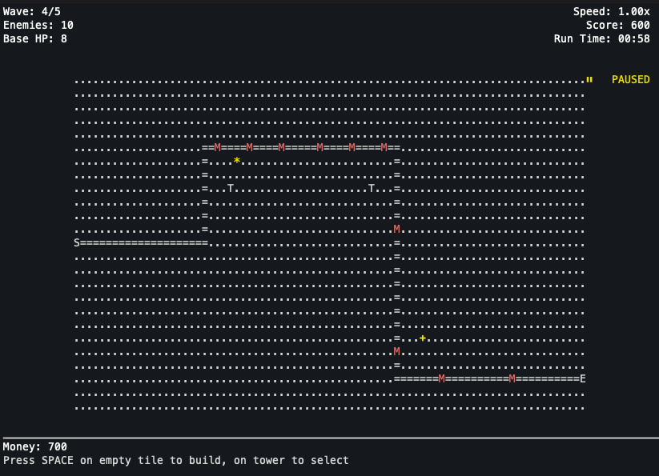

# Terminal Tower Defense 👾

A terminal-based tower defense game built with Go and tcell. It also ships an
[MCP](https://modelcontextprotocol.io) server, so an AI agent can design maps
and waves over stdio and you play the result in the game. See **AI maps (MCP)**
below.



## Install 📦

### Option 1: Homebrew (macOS, recommended)

```bash
brew tap Larry8668/terminal-td
brew install --cask terminal-td
```

If Homebrew refuses the tap with an "untrusted tap" error, trust it first
(a one-time step Homebrew requires for third-party taps in general, not
specific to this project) and re-run the install:

```bash
brew trust larry8668/terminal-td
```

Homebrew installs are unaffected by the Gatekeeper warning below — the cask
strips the quarantine flag automatically. Updates go through
`brew upgrade --cask terminal-td` (the in-app updater is disabled for
Homebrew installs).

### Option 2: Download a prebuilt binary

Grab the archive for your platform from the
[Releases page](https://github.com/Larry8668/terminal-td/releases) (`.tar.gz`
for macOS/Linux, `.zip` for Windows), extract it, and run the binary inside.

> 🚧 **macOS:** a manually downloaded binary may be blocked by Gatekeeper
> ("cannot be opened" / "not verified") since it's unsigned (code signing
> requires a paid Apple Developer account). Fix it with:
>
> ```bash
> xattr -d com.apple.quarantine /path/to/terminal-td
> ```
>
> (use the actual extracted path). Not needed with the Homebrew install above.

### Option 3: Build from source

```bash
go run cmd/game/main.go
```

Or build and run:

```bash
go build -o terminal-td cmd/game/main.go
./terminal-td
```

## Controls 🎮

**Movement:**
- Arrow Keys or `WASD` - Move cursor

**Building:**
- `B` - Toggle build mode
- `SPACE/ENTER` - Place tower / Select tower
- `ESC` - Cancel / Deselect

**Gameplay:**
- `P` - Pause / Unpause
- `+/-` - Increase / Decrease game speed
- `R` - Restart (when game over)

**Quit:**
- `ESC` - Quit game (with confirmation)

## Features 🪄

- Tower placement and management
- Enemy waves with increasing difficulty
- Projectile-based combat system
- Real-time range visualization
- Economy system (earn money from kills)
- Wave progression system
- MCP server so an agent can author, check, and simulate custom maps

## AI maps (MCP) 🤖

`terminal-td serve` speaks the Model Context Protocol over **stdio**. Cursor,
Claude Desktop, and other MCP clients launch that binary as a subprocess and
talk to it on stdin and stdout. Typing `terminal-td serve` yourself prints
setup help and exits: a real client connects through a pipe, so a keyboard
session is treated as a mistake. While a client has the process open, stdout
carries protocol traffic only. Logs go to `terminal-td-session-*.log` in the
config directory below.

### Connect it

Use the installed binary (Homebrew or a release), or one you built with
`go build -o terminal-td cmd/game/main.go`. Point the client at that path:

```json
{
  "mcpServers": {
    "terminal-td": {
      "command": "terminal-td",
      "args": ["serve"]
    }
  }
}
```

- **Cursor:** `.cursor/mcp.json` in the project, or Cursor Settings → MCP.
- **Claude Desktop:** `claude_desktop_config.json`.

If `terminal-td` is not on the client's PATH, set `command` to the full path.
A Homebrew install on Apple Silicon is usually
`/opt/homebrew/bin/terminal-td`.

You can also paste this to the assistant you already have open and let it
write the config for whatever tool you're in:

```text
Set up a local MCP server for me:
  command: terminal-td
  args: ["serve"]

Add it to this tool's MCP config, enable it, and list its tools.
```

A working connection exposes the eight tools below. Ask the agent to call
`get_game_rules` before it designs anything. That call returns the tile,
tower, enemy, and wall rules, the map and wave JSON shapes, and a difficulty
target.

### What it offers

| Tool | What it does |
| --- | --- |
| `get_game_rules` | Rules manual and the JSON shapes for maps and waves. Call this first. |
| `list_maps` | Every map, built-in and yours: id, name, source, grid size, spawn count. |
| `get_map` | One map as authored, including fork paths, plus its waves. |
| `validate_map` | Checks a map without saving it. Structure first, then that every spawn can reach the base. Returns `valid`, `errors`, `warnings`, and path lengths. An invalid map is a normal result. |
| `create_map` | Validates and saves a map so it shows up in the game. Fails if the map is invalid. `overwrite: true` replaces a user map with the same id. |
| `create_waves` | Validates and saves waves for a map id. Each group has to name a spawn that exists on that map. |
| `simulate_run` | Headless, deterministic playthrough of a saved map. Pass `waves` to try a wave list without saving it; otherwise the map's own waves are used. `bot` is `none` (no towers) or `greedy`. `budget` of `0` means the game default of 500. A loss comes back as `outcome: "lost"`, which is a result, not a tool error. The same inputs always produce the same result. |
| `delete_map` | Deletes a user map and its waves file. Built-in maps cannot be deleted. |

Saved maps go under `maps/`, and waves under `waves/<map-id>.json`, inside
the user config directory:

- macOS: `~/Library/Application Support/terminal-td/`
- Linux: `~/.config/terminal-td/` (or `$XDG_CONFIG_HOME/terminal-td`)
- Windows: `%AppData%\terminal-td\`

Open map select in the game and the new map is there, marked with `*`. A
user map whose id matches a built-in one is the one you play; the built-in
file is left in place. `delete_map` removes only that user copy.

The agent writes the level, checks that every spawn still reaches the base,
and simulates whether it is beatable. You play the saved map yourself. It
does not drop a level into a match that is already running.

## Requirements 📝

- Go 1.25+
- Terminal with UTF-8 support

## Building 🔧

Build for your platform:

```bash
go build -o terminal-td cmd/game/main.go
```

Cross-compile for other platforms:

```bash
# Windows
GOOS=windows GOARCH=amd64 go build -o terminal-td.exe cmd/game/main.go

# Linux
GOOS=linux GOARCH=amd64 go build -o terminal-td cmd/game/main.go

# macOS
GOOS=darwin GOARCH=amd64 go build -o terminal-td cmd/game/main.go
```

Or use the [build script](build.sh) to build for all platforms.

**Build script:** `./build.sh [platform]` produces versioned folders and zips in `builds/` (e.g. `terminal-td-v0.1.2-windows-amd64/` and `terminal-td-v0.1.2-windows-amd64.zip`). Each folder/zip contains the game binary and `readme.txt`. Default `all`; use `./build.sh --help` for options. This is a manual/legacy path -- tagged releases are built and published by [GoReleaser](.goreleaser.yaml) via CI (see `.github/workflows/release.yml`), which also updates the Homebrew cask.

**Auto-update:** With "Check for updates" on in Settings, the game notifies when a newer GitHub release exists. Choosing "Update available" downloads the archive for the current platform, extracts it, and replaces the running binary in place; reopen the game afterward to run the new version. Installs via Homebrew skip this entirely -- `brew upgrade --cask terminal-td` is the update path there instead.

---